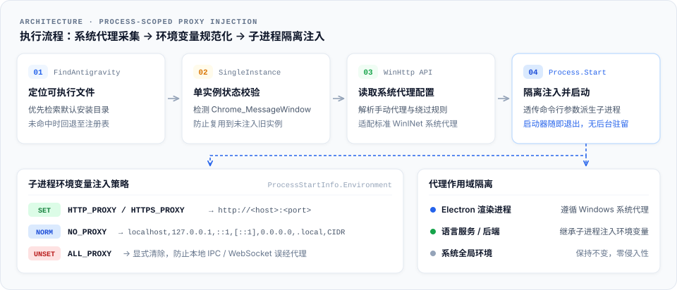

# AntigravityProxy

[](https://github.com/haoch1/AntigravityProxy)
[](https://github.com/haoch1/AntigravityProxy)

面向 Windows 平台的 Antigravity 桌面版轻量级代理启动器。在启动 `Antigravity.exe` 时自动采集当前 Windows 系统代理配置，将规范化后的 `HTTP_PROXY`、`HTTPS_PROXY` 与 `NO_PROXY` 仅注入至目标子进程环境，启动完成后即刻退出，无后台常驻进程，亦不修改系统全局环境变量。

---

## 背景与定位

Antigravity 桌面版基于 Electron 架构，其网络栈存在两层分离：

| 组件层级 | 代理配置来源 | 典型问题 |
| :--- | :--- | :--- |
| Electron / Chromium 渲染进程 | 自动读取 Windows 系统代理（WinINet） | 仅开启系统代理时前端连通，但后端未必生效 |
| 底层语言服务与后端子进程 | 依赖标准进程环境变量（`HTTP_PROXY` / `HTTPS_PROXY` / `NO_PROXY`） | 若写入系统全局环境变量，会污染其他应用且端口变更后易残留失效 |

**AntigravityProxy** 以单文件 C# 启动器的方式在进程创建阶段完成代理桥接：

- **零外部依赖**：直接调用 Windows 内置 `.NET Framework 4.x` 编译器（`csc.exe`）构建为独立可执行文件，无需安装 .NET SDK 或 Visual Studio。
- **进程级隔离**：仅对本次派生的 `Antigravity.exe` 及其子进程注入代理环境变量，不触碰系统/用户级环境变量。
- **零常驻开销**：启动目标进程后立即退出，不占用后台内存或系统托盘。

---

## 工作原理

<picture>
  <source media="(prefers-color-scheme: dark)" srcset="./docs/workflow-dark.svg">
  <source media="(prefers-color-scheme: light)" srcset="./docs/workflow-light.svg">
  
</picture>

### 执行阶段说明

1. **可执行文件定位（`FindAntigravity`）**
   - 优先检测标准安装目录（`%LOCALAPPDATA%\Programs\Antigravity`、`%ProgramFiles%\Antigravity`、`%ProgramFiles(x86)%\Antigravity`），常规环境下耗时约 1–3 ms；
   - 未命中时依次回退检索 `HKCU`/`HKLM` 下的 `App Paths` 与 `Uninstall` 注册表项，全程采用纯字符串解析，避免正则表达式引擎冷启动开销。

2. **单实例状态校验（`CheckForOpenWindow`）**
   - 当主窗口关闭并最小化至系统托盘时，Electron 后台进程仍处于运行状态。若此时直接启动新进程，Electron 单实例机制会将启动请求转发至既有进程，导致新注入的环境变量无法生效；
   - 启动器通过 Win32 API `FindWindowEx` 检索隐藏消息窗口 `Chrome_MessageWindow`（窗口标题为 `%APPDATA%\Antigravity`），并结合进程主窗口路径校验，确保仅在无残留实例时执行注入启动。

3. **系统代理读取（`ConfigureProxy`）**
   - 调用 `winhttp.dll` 导出的 `WinHttpGetIEProxyConfigForCurrentUser` 接口读取当前用户的手动代理配置（`Server`）与绕过列表（`Bypass`）；
   - 兼容所有遵循 Windows 标准系统代理机制的客户端（包括 Clash Verge、Mihomo Party、Clash Nyanpasu、FlClash、v2rayN、sing-box 等）。

4. **环境变量规范化（`BuildBypassList` / `SetEnvironmentVariable`）**
   - 通过 `ProcessStartInfo.Environment` 精确写入大写变量名 `HTTP_PROXY`、`HTTPS_PROXY`、`NO_PROXY`，并在写入前清除可能继承的大小写同名变量；
   - **显式清除 `ALL_PROXY`**：避免将 `http://` 代理端点写入 `ALL_PROXY`，防止非 HTTP 协议、本地 WebSocket 或 IPC 组件误经代理并引发连接超时；
   - **`NO_PROXY` 标准化**：
     - 默认前置本地回环地址：`localhost,127.0.0.1,::1,[::1],0.0.0.0`（同时包含 `::1` 与 `[::1]`，以兼容 Node.js WHATWG `URL.hostname` 对 IPv6 地址保留方括号的匹配行为）；
     - 将 Windows 通配符格式 `*.local` 转换为 POSIX/Go/Node 通用的前导点格式 `.local`；
     - 将前缀通配符（如 `127.*`、`192.168.*`、`10.*`）转换为标准 CIDR 表示法，并将连续的 16 条 `172.16.0.0/16`–`172.31.0.0/16` 自动归并为 `172.16.0.0/12`。

5. **进程派生与参数透传（`Main`）**
   - 使用 `UseShellExecute = false` 启动 `Antigravity.exe`，完整透传外部命令行参数并正确处理引号转义；派生完成后启动器进程以退出码 `0` 立即终止。

---

## 编译与使用

### 运行前提

- 操作系统：Windows 10 / Windows 11（系统自带 `.NET Framework 4.x`，无需额外安装 SDK）
- 已安装 Antigravity 桌面版
- 本地代理客户端已启用 Windows「系统代理」（手动 HTTP/HTTPS 模式）

### 编译命令

在 PowerShell 中直接调用系统内置的 `csc.exe` 编译：

```powershell
& "$env:WINDIR\Microsoft.NET\Framework64\v4.0.30319\csc.exe" `
  /nologo /target:winexe /optimize+ /platform:x64 /utf8output `
  /out:"Antigravity Proxy.exe" Launcher.cs
```

如需为生成的可执行文件嵌入自定义图标，附加参数 `/win32icon:<图标文件路径.ico>` 即可。

### 使用步骤

1. 在代理客户端中启用 Windows「系统代理」；
2. 如 Antigravity 当前处于运行或托盘常驻状态，先通过托盘菜单完全退出；
3. 运行编译生成的 `Antigravity Proxy.exe`（可将其放入任意目录并固定至开始菜单或任务栏）。

---

## 配置修改与二次适配指南

全部逻辑均位于 [`Launcher.cs`](./Launcher.cs) 中，修改后重新执行上述编译命令即可生效。

### 1. 适配其他代理客户端

对于启用了 Windows「系统代理」的任意客户端（Clash Verge、v2rayN、Mihomo Party、FlClash、sing-box 等），**无需修改源码即可直接使用**。如需自定义弹窗文案，修改 `ConfigureProxy()` 内的异常提示即可：

```csharp
if (!WinHttpGetIEProxyConfigForCurrentUser(out system))
    throw new InvalidOperationException("无法读取 Windows 系统代理。请确认代理软件已开启“系统代理”。");
```

### 2. 使用固定代理端点（适用于 TUN 模式或未开启系统代理的场景）

若不希望依赖 Windows 系统代理配置（例如采用 TUN 虚拟网卡或 PAC 模式），可将 `ConfigureProxy()` 替换为固定端点注入：

```csharp
private static void ConfigureProxy(ProcessStartInfo start)
{
    const string proxy = "http://127.0.0.1:7897"; // 替换为实际本地监听地址

    IDictionary<string, string> env = start.Environment;
    SetEnvironmentVariable(env, "HTTP_PROXY", proxy);
    SetEnvironmentVariable(env, "HTTPS_PROXY", proxy);
    RemoveEnvironmentVariable(env, "ALL_PROXY");
    SetEnvironmentVariable(
        env,
        "NO_PROXY",
        "localhost,127.0.0.1,::1,[::1],0.0.0.0,127.0.0.0/8,10.0.0.0/8,172.16.0.0/12,192.168.0.0/16,.local"
    );
}
```

> **提示**：当系统代理关闭时，Electron 渲染层不会自动使用上述环境变量。如需同时指定渲染层代理，可在 `Main()` 中向 `start.Arguments` 追加 `--proxy-server=http://127.0.0.1:7897`。

### 3. 指定自定义安装路径（便携版或非标准目录）

若 `Antigravity.exe` 位于非默认目录且无注册表记录，可在 `FindAntigravity()` 入口处前置自定义目录检测：

```csharp
private static string FindAntigravity()
{
    string custom = InDirectory(@"<你的 Antigravity 安装目录>");
    if (custom != null)
        return custom;

    // 保留原有默认目录与注册表回退逻辑 ...
}
```

### 4. 扩展 `NO_PROXY` 绕过列表

- **方式 A（推荐）**：直接在代理客户端的「系统代理绕过列表（Proxy Override）」中维护规则，启动器将在启动时自动同步并完成格式转换；
- **方式 B（代码级默认规则）**：在 `BuildBypassList()` 的初始集合中追加内网域名或网段：

```csharp
var values = new List<string>
{
    "localhost", "127.0.0.1", "::1", "[::1]", "0.0.0.0",
    ".corp.internal", "100.64.0.0/10"
};
```

### 5. 注入额外环境变量或固定启动参数

- **附加环境变量**：在 `ConfigureProxy()` 末尾调用 `SetEnvironmentVariable(env, "KEY", "VALUE");`（如 `SSL_CERT_FILE`、`NODE_EXTRA_CA_CERTS` 等）；
- **固定命令行参数**：在 `Main()` 构造 `ProcessStartInfo` 时向 `Arguments` 拼接所需标志（如 `--user-data-dir`）。

### 6. 迁移至其他 Electron 桌面应用

如需复用于其他基于 Electron 的桌面软件，仅需替换 [`Launcher.cs`](./Launcher.cs) 中与目标程序相关的标识项：

| 修改位置 | 涉及标识 | 说明 |
| :--- | :--- | :--- |
| 类常量 | `ExecutableName`、`AppPaths` | 目标 `.exe` 文件名及 `App Paths` 注册表路径 |
| `CheckForOpenWindow` | `profile` 目录名、进程名 | `%APPDATA%` 下的 Chromium Profile 目录及进程名 |
| `FindAntigravity` | 默认安装子目录 | `%LOCALAPPDATA%\Programs\<App>` 等默认目录 |
| `IsAntigravityDisplayName` | 应用显示名前缀 | `Uninstall` 注册表项中的 `DisplayName` 匹配规则 |
| `Main` 异常处理 | `MessageBox` 标题与文案 | 异常提示窗口标题 |

---

## 常见问题

<details>
<summary><strong>为什么提示「Antigravity 已在运行」？</strong></summary>

关闭主窗口后，Antigravity 默认保持托盘后台常驻。此时若再次启动新进程，Electron 单实例机制会忽略新进程环境并激活旧实例，导致代理环境变量不会更新。请先在系统托盘右键彻底退出主程序，再通过本启动器重新启动。

</details>

<details>
<summary><strong>是否支持 PAC（自动配置脚本）模式？</strong></summary>

当前仅解析 Windows 手动 HTTP/HTTPS 系统代理。PAC 模式下系统不会写入静态 `ProxyServer`，且后端进程无法直接执行 `.pac` 脚本。建议切换为手动系统代理模式（规则/全局分流由代理客户端接管），或参考上文「使用固定代理端点」章节进行配置。

</details>

<details>
<summary><strong>修改代理端口或切换代理开关后需要如何操作？</strong></summary>

环境变量仅在子进程创建时注入一次，运行期间不会热更新。若调整了代理软件的监听端口，请彻底退出 Antigravity 后重新通过本启动器启动。

</details>
